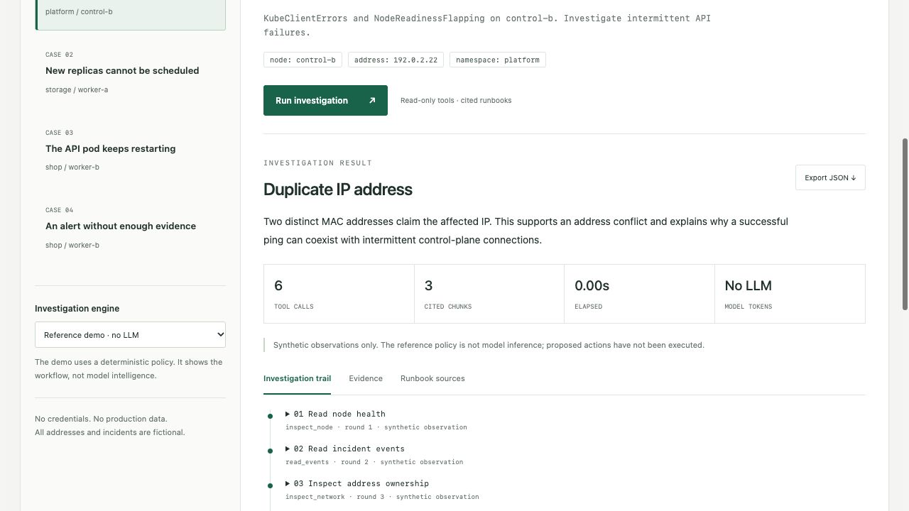
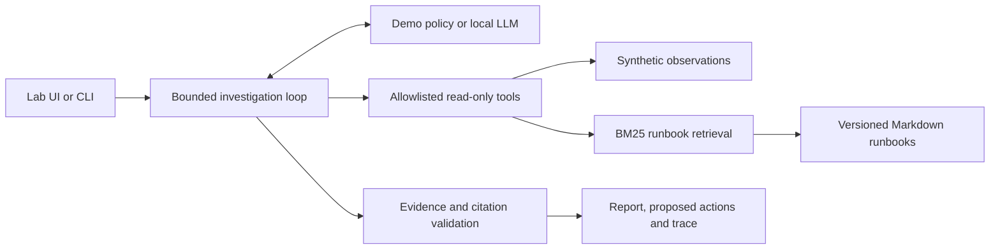

# Incident Investigator

**An evidence-first investigation lab for infrastructure incidents.**

An alert is a starting point, not a diagnosis. This project connects a bounded investigator to read-only evidence tools and a searchable runbook collection. Every accepted report includes observed evidence, retrieved source IDs, proposed next steps, and explicit limitations.

Built by Karem Elbostany as the operations-intelligence companion to the [Karm DevOps Platform](https://github.com/egyhaty/karm-devops).

## Portfolio context

This repository is the second layer of a two-project platform story:

| Layer | Project | Demonstrates |
|---|---|---|
| Platform | [karm-devops](https://github.com/egyhaty/karm-devops) | Kubernetes, GitOps, networking, storage, observability and delivery automation |
| Operations intelligence | Incident Investigator | LLM tool use, retrieval, evidence validation, evaluation and safe incident reasoning |

The projects are intentionally decoupled. This repository remains runnable with synthetic fixtures and does not contain private cluster data, credentials, or an automatic remediation path.



## Try it in two minutes

Requires Python 3.11+; the fixture-backed application has **no third-party runtime dependencies**.

```bash
python3 -m investigator serve
# Open http://localhost:8080
```

Select a case and click **Run investigation**. Inspect the trail, evidence, and runbook source tabs, then export the full JSON report.

```bash
python3 -m investigator investigate --scenario duplicate-ip
python3 -m unittest discover -s tests -v
python3 scripts/evaluate.py --output artifacts/demo-evaluation.json
```

The repository runs directly from its root. Installing it with `python3 -m pip install .` also exposes the `investigator` command.

## What the two modes actually do

| Mode | Decision making | Requirements | What it demonstrates |
|---|---|---|---|
| Reference demo | Transparent deterministic policy | Python only | Tool orchestration, retrieval, report validation, UI and observability |
| Local LLM | An Ollama model chooses tools and generates a report | Running Ollama and an installed tool-capable model | A real bounded tool-calling agent and retrieval-augmented generation |

**A successful demo evaluation is not an AI accuracy benchmark.** The demo is labeled everywhere and does not silently become an LLM. Provider integration is tested with a local protocol stub; that test is not real inference.

To enable local inference, install a tool-capable model using the official [Ollama tool-calling guide](https://docs.ollama.com/capabilities/tool-calling), then pass its exact installed name:

```bash
python3 -m investigator serve --model YOUR_INSTALLED_MODEL
# Choose Local LLM in the UI.
python3 -m investigator investigate --provider ollama --model YOUR_INSTALLED_MODEL --scenario duplicate-ip
python3 scripts/evaluate.py --provider ollama --model YOUR_INSTALLED_MODEL --output artifacts/model-evaluation.json
```

No model is downloaded automatically, no cloud API is called, and no paid provider credentials are required. Ollama endpoints are restricted to loopback. A missing model or unavailable service returns an explicit failure; it never falls back to the demo while claiming inference.

## The architecture



The model sees an alert and resource identifiers, not an expected diagnosis or scenario answer. It chooses tool calls, receives observations, and can adjust its next step. The runtime enforces the tool allowlist, argument schemas, duplicate-call checks, round/tool/token budgets, and a deadline. The final diagnosis must satisfy an evidence predicate, and all cited evidence and chunk IDs must have been retrieved in that investigation.

The reference policy intentionally reads all five observation groups before retrieving runbooks. Its ordering varies with event evidence, but it is a deterministic workflow. This is different from the LLM mode, where the model selects tools.

### Retrieval is intentionally inspectable

Markdown runbooks are split by section and assigned content-derived IDs. A BM25 lexical index ranks relevant chunks. LLM mode uses retrieved text to generate the report; demo mode uses it to demonstrate source selection and citation plumbing. This is a lexical RAG baseline, **not embeddings, a vector database, reranking, or semantic search**.

## Included cases

| Case | Evidence that matters | Expected result |
|---|---|---|
| Duplicate IP | Two distinct ARP responders for one address | Address conflict |
| Replica scheduling | Provisioned capacity exceeds scheduling limit despite free space | Scheduling capacity problem |
| Restarting application | OOMKilled with usage near a container limit | Container memory pressure |
| Unexplained latency | Basic checks do not establish a cause | Insufficient evidence; request traces |

All data is fabricated. Addresses use the documentation-only `192.0.2.0/24` range. No real hostnames, customer records, logs, credentials, or operational datasets are included.

## Safety boundaries and limitations

- Fixture reads and local runbook search are the only tools. There is no shell, live Kubernetes connector, mutation API, arbitrary path, or arbitrary URL tool.
- Logs and retrieved documents are untrusted data. Tool capability checks are enforced in Python, independently of model instructions.
- Diagnosis predicates prevent several unsupported labels. Valid citations prove reference provenance, **not semantic truth or complete prompt-injection resistance**. Model summaries and proposed actions still need human review.
- Limits: 9 model rounds, 12 tool calls, at most 3 calls per round, 16,000 reported tokens, 90-second investigation budget, and a 25-second timeout per model request. A request in flight may finish after the investigation deadline; its result is then rejected. This is not process isolation.
- The HTTP server is a local research/demo server with basic request bounds, Origin/Host checks, no CORS, a strict CSP, and two concurrent investigation slots. It is **not a hardened public multi-user production service**. Do not expose it directly to the internet.
- Runbook content and tool outputs are visible in the trace; only synthetic data is supported.

## API and observability

```bash
curl -s http://localhost:8080/api/scenarios
curl -s http://localhost:8080/api/investigate \
  -H 'Content-Type: application/json' \
  -d '{"scenario_id":"duplicate-ip","provider":"demo"}'
curl -s http://localhost:8080/metrics
```

`/healthz` and `/readyz` check the local application, not model availability. `/metrics` exposes completed/failed investigation counts, cumulative duration, and model token counts. These counters reset with the process. No dollar-cost estimate is invented; demo mode reports zero model tokens.

See [the portfolio map](docs/PORTFOLIO.md), [the evaluation guide](docs/EVALUATION.md), [the architecture walkthrough](docs/ARCHITECTURE.md), [the implementation status](docs/STATUS.md), and [the recorded validation](docs/VALIDATION.md).

## Container and Kubernetes lab

```bash
docker build -t incident-investigator:0.1.0 .
docker run --rm --read-only --cap-drop ALL --security-opt no-new-privileges \
  -p 127.0.0.1:8080:8080 incident-investigator:0.1.0
```

`deploy/kubernetes.yaml` is an optional fixture-only lab deployment. Build/load the image into your lab or replace it with your reviewed registry image before applying. It has no ingress, cluster credentials, or service-account token. Use `kubectl -n incident-investigator port-forward svc/investigator 8080:8080`. Review the manifest and network policy in your environment first. The image and manifests are provided but do not imply a successful deployment. Pin a tested base-image digest before a release.

## Next milestones

1. Run and record a real model evaluation, including failures and abstentions.
2. Expand the dataset with counterexamples, ambiguous incidents, and adversarial retrieval tests.
3. Add hybrid retrieval only after measuring a weakness in the lexical baseline.
4. Add an isolated, least-privilege Kubernetes connector with namespace scope and a separate integration test cluster.
5. Add durable traces, authentication, a production server, and deployment validation before public hosting.
6. Connect a separately configured, least-privilege evidence adapter only after the synthetic boundary is reviewed.
